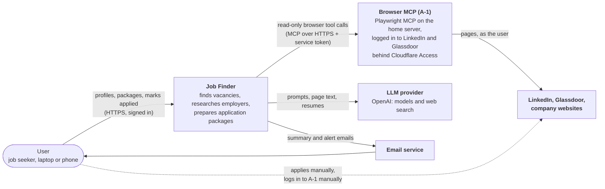
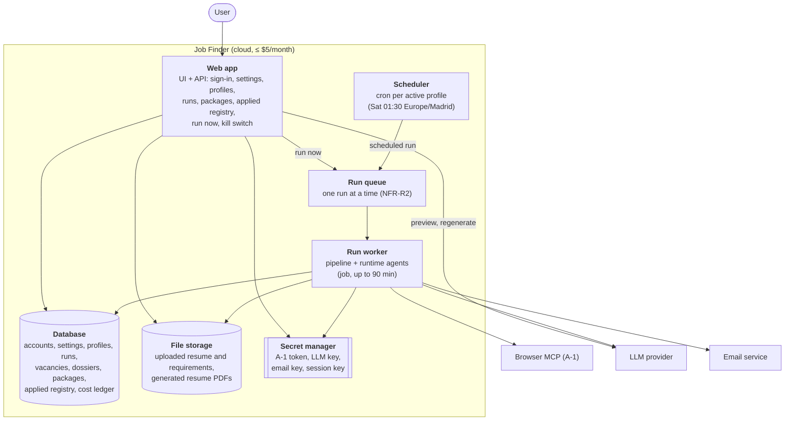
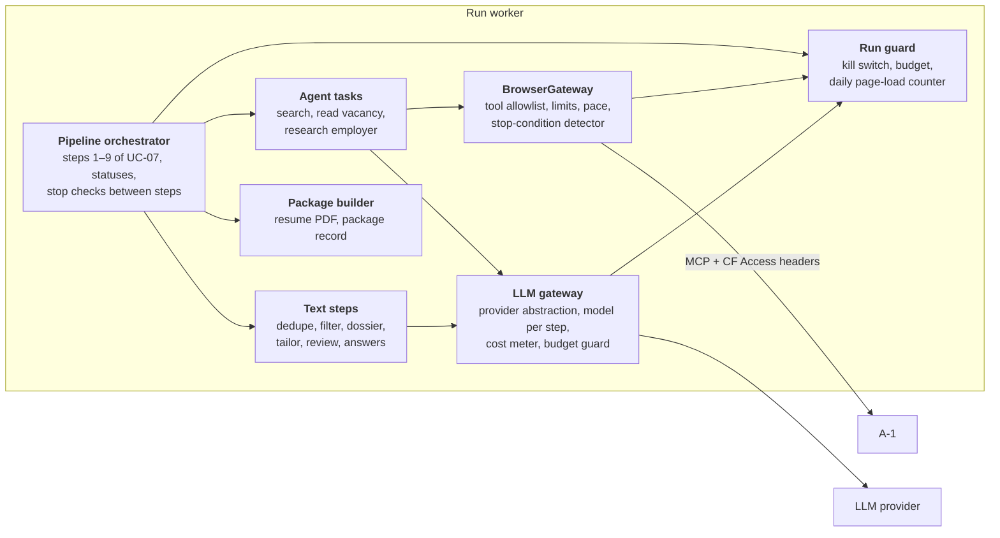
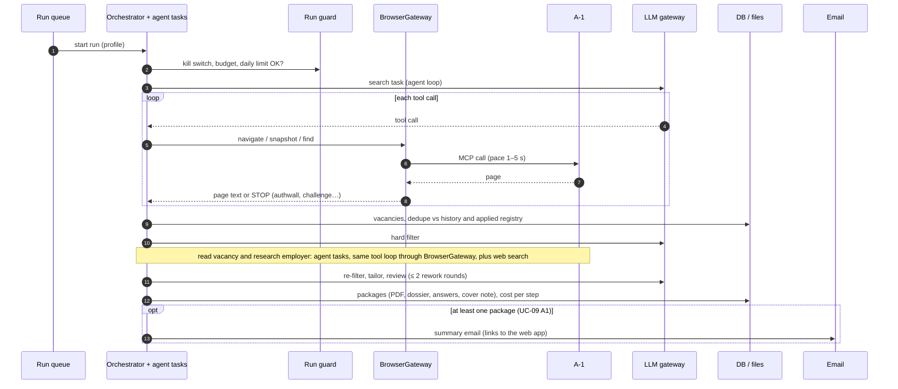
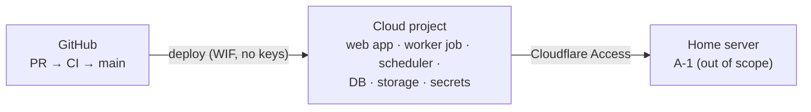

# Architecture (draft)

| | |
|---|---|
| **Status** | Draft — shapes the P2 ADRs; each open question below is settled by its ADR, then this page is updated |
| **Date** | 2026-11-24 |
| **Issue** | #14 |
| **Inputs** | [Vision](vision.md), [use cases](requirements/use-cases.md), [NFR](requirements/nfr.md), spikes: [browser flows](spikes/browser-flows.md), [LLM cost](spikes/llm-cost.md), [application channels](spikes/application-channels.md); decisions in #19 (short-task agents over Browser MCP) and #4 (packages, no submission) |

Technology names here (GCP, OpenAI, Playwright MCP) are the current assumptions from the vision and spikes. Products for hosting, storage, auth and email are chosen in their ADRs.

## 1. Context (C4 level 1)

| External system | What Job Finder needs from it | Trust |
|---|---|---|
| A-1 Browser MCP | Navigate and read pages with the user's sessions (A-1, A-2) | Its **output is untrusted** (vacancy text can carry prompt injection); the service token is a secret |
| LinkedIn, Glassdoor, company sites | Vacancies and employer signals; reached only through A-1, read only | Never contacted directly by Job Finder |
| LLM provider | Agents for browsing tasks, extraction, filtering, dossier, tailoring, review; web search for the dossier | Receives personal data (resume) — only what a step needs (NFR-P5) |
| Email service | Summary after a run, alerts on blocked runs and budget | Receives package links, not package content |

Out of scope: building and operating A-1; logging in to job boards (the user does it on A-1); submitting applications.

## 2. Containers (C4 level 2)

| Container | Responsibility | Notes for the ADRs |
|---|---|---|
| **Web app** | All user-facing pages and the API behind them (UC-01–05, 10–15); resume a blocked run and re-enable a paused job board (UC-08). **Interactive LLM steps** that do not browse run here, outside the run queue: extraction preview on upload (UC-03, ≤ 30 s, NFR-F3), regenerating answers (UC-11 A1), regenerating and re-reviewing a resume after a rejected added skill (UC-12) | Responsive at 360 px (NFR-U1); every route authenticated, owner only (NFR-S1); may scale to zero, cold start ≤ 10 s accepted (NFR-A1); uses the same LLM gateway as the worker, so cost and the budget cap apply |
| **Scheduler** | Enqueues a run for each active profile at its slot (UC-06) | A managed cron is enough; no logic in it |
| **Run queue** | Serialises runs: at most one running (A-4, NFR-R2); drops queued runs when the kill switch is on (UC-14) | Concurrency 1; a DB row lock may be all that is needed |
| **Run worker** | Executes UC-07 end to end for one run, then sends the summary (UC-09) | Long-running (30–90 min, NFR-R3) — rules out request-bound serverless functions with short timeouts; the **only** container that holds the A-1 token |
| **Database** | All structured data; the cost ledger and counters that enforce limits | Small: one user, ≤ 3 profiles; backups daily, 7 days (NFR-A6); retention jobs (NFR-P3) |
| **File storage** | Uploaded files and generated PDFs | Private; links in emails go to the web app, never to public objects |
| **Secret manager** | A-1 service token (worker only), LLM API key (worker and web app), email credentials (worker), sign-in secrets such as a session signing key (web app) (NFR-S2) | Rotation every 90 days (NFR-S5) |

Web app and worker can be one codebase with two entry points (decided with the stack, #46).

## 3. Run worker components

| Component | Responsibility | Requirements |
|---|---|---|
| **Pipeline orchestrator** | Runs the steps in order, records status per vacancy (*prepared, skipped by filter, failed*), continues past single failures, stops on blocked conditions | UC-07 A1–A6, UC-08, NFR-A5, NFR-O1 |
| **Agent tasks** | Short browsing tasks with a fresh context, small tool set and turn limit: "search with these criteria", "open vacancy X and extract", "research company Y". Return structured data; raw page text is dropped after extraction | #19 option C; spike #2 §7 |
| **Text steps** | Single LLM calls on structured data: dedupe matching, hard filter, dossier synthesis (with web search), re-filter, tailor, review (max 2 rework rounds), answers and cover note | Vision §9, NFR-Q1, Q2; `resume-rules` skill |
| **BrowserGateway** | The only way to reach A-1 (NFR-M2). Allows only read tools (navigate, snapshot, find, click, back, tab list/close); no typing into forms, uploads, JavaScript or `filename` params. Search uses URL parameters where they work; clicks are needed for some LinkedIn filters and pagination (spike #2), so which clicks are allowed is settled in #20. Enforces per-run and per-day limits, the random 1–5 s pace, and detects login pages, authwalls, CAPTCHAs, challenges and restriction notices → stop | NFR-B1–B7, NFR-S6, NFR-S8 |
| **LLM gateway** | Provider abstraction and model per step (Luna for browsing, extraction, filtering, tailoring; Sol for review); records tokens and cost per step; refuses the next call when the monthly cap is reached | NFR-M1, NFR-C2–C4, NFR-P5 |
| **Run guard** | Checked before every step and every browser call: kill switch, budget, daily page-load counter per job board, schedule paused after a restriction notice | UC-14, UC-08 A1, NFR-O3, NFR-B5 |
| **Package builder** | Renders the tailored resume to a text-selectable PDF ≤ 2 MB with added skills highlighted; stores the package before the summary is sent | NFR-F4, NFR-R5 |

### Where the agent loop runs

Spike #3 ran browsing agents through the LLM provider's **hosted MCP tool**: the provider's servers called A-1 directly. Pages went blank between calls, likely because each provider connection got a new browser context. Besides that bug, a hosted MCP tool puts the provider between the agent and A-1, so Job Finder cannot pause between tool calls, count page loads or stop on an authwall before the next call, and the A-1 token is handed to the provider on every request.

This draft therefore assumes the **agent loop runs in the worker**: the worker calls the model with tool definitions, executes each tool call itself through `BrowserGateway` over one persistent MCP session, and returns the result to the model. The model never talks to A-1. Same models and option C, but the limits, pace, stop conditions and allowlist become deterministic code — not instructions to the model. To be confirmed in the agent runtime ADR (#19) and the browser policy ADR (#20). The vision (§12) lists `--shared-browser-context` on A-1 as the first fix for blank pages; it is still worth enabling (it keeps one context for the worker's session), but this draft does not depend on the hosted tool working.

## 4. A run, step by step

A blocked condition at any browser call ends the run as *blocked: reason*, keeps what is done and sends an alert (UC-08). The guard is checked again before each step (kill switch ≤ 1 min, NFR-O3).

## 5. Data (conceptual)

| Entity | Key fields | Personal data | Retention (NFR-P3) |
|---|---|---|---|
| Account, Settings | email, notification email, re-apply period, kill switch, paused job boards (UC-08 A1) | email | until deleted |
| Profile | name, active, schedule, resume file, requirements file, extracted fields | **resume** | until deleted |
| Run | profile, trigger, status, counts, cost per step, duration, errors | — | 12 months |
| Vacancy | source, job id, link, company, title, status, skip reason | — | with the run |
| Dossier | company, facts with source links, missing sources | — | 90 days unless applied |
| Package | vacancy, resume PDF, added skills (+ rejected), answers, cover note, reviewer notes, channel | **resume content** | 90 days unless applied |
| Applied registry entry | position, company, source, link, channel, profile, date, package | links to package | until deleted |
| Cost ledger, page-load counters | month, provider, cost; board, day, count | — | 12 months |

Matching against the applied registry: same source and job id, or same company and position title (UC-15).

## 6. Trust boundaries and cross-cutting concerns

| Concern | Approach | Requirements |
|---|---|---|
| **Prompt injection** | Page text is data. Browsing agents can only call read tools through `BrowserGateway`; text steps have no tools. Nothing can submit, type into forms or run JavaScript | NFR-S6, NFR-B1 |
| **Secrets** | Only the worker reads the A-1 token; the LLM key is read by the worker and the web app; all from the secret manager, never in logs, prompts or images | NFR-S2 |
| **Personal data** | Resume goes to the LLM only for steps that need it; not logged; traces ≤ 30 days; deletion within 24 h | NFR-P1–P6 |
| **Cost** | Budget guard in the LLM gateway; cost ledger per step; monthly cap $10, alert $5; hosting budget alerts | NFR-C1–C5 |
| **Being a polite guest** | Counters and pace in `BrowserGateway`; stop at once on any challenge; restriction pauses that board | NFR-B2–B7 |
| **Observability** | Run record with counts, cost, duration, per-vacancy reason; email on blocked, failed and budget events | NFR-O1–O3 |
| **Testability** | `BrowserGateway` and LLM gateway are interfaces; tests use recorded pages and a fake MCP server; evals gate prompt and model changes | NFR-M5, NFR-Q4, #24, #25 |

## 7. Deployment (to be decided)

All cloud resources by Terraform from CI (NFR-M3, NFR-S4). GCP is the preferred provider (account exists); the free tier decides the services and the region (NFR-P2).

## 8. Open questions → ADRs

| # | Question | ADR issue | Leaning in this draft |
|---|---|---|---|
| Q1 | Language, framework, web UI approach, agent SDK; one codebase with web and worker entry points? | #46 | One codebase, two entry points |
| Q2 | Which cloud services run the web app, the 30–90 min worker, the scheduler, within $5/month | #15 | Container platform with scale-to-zero for the web; a job runner without short timeouts for the worker |
| Q3 | Terraform layout, state, environments, CI access | #16 | One environment for the MVP |
| Q4 | Sign-in for one owner, working on phone and desktop | #17 | Managed identity provider, allow-list of one account; its secrets in the secret manager |
| Q5 | Database and file storage; backups, retention, deletion | #18 | Managed, free-tier; resume upload to A-1 no longer needed (#4) |
| Q6 | Agent harness; **agent loop in the worker vs hosted MCP tool**; provider abstraction; model per step | #19 | Loop in the worker, one persistent MCP session (§3) |
| Q7 | Browser tool allowlist, limits, stop triggers, ban-risk exit criteria; `--shared-browser-context` on A-1 | #20 | Enforced in `BrowserGateway` |
| Q8 | Email channel for summaries and alerts; SPF/DKIM | #21 | Transactional email API, free tier. Email *applications* are out of the MVP (#4) |
| Q9 | Run queue: managed queue or a DB lock | #15, #19 | DB lock if the platform allows one worker at a time |
| Q10 | PDF rendering of the tailored resume | #46 | Library in the chosen stack; checked against NFR-F4 |

Issue text to adjust: #21 still mentions email applications (out of the MVP since #4); #18's "resume delivery to A-1" is no longer needed for the MVP.
