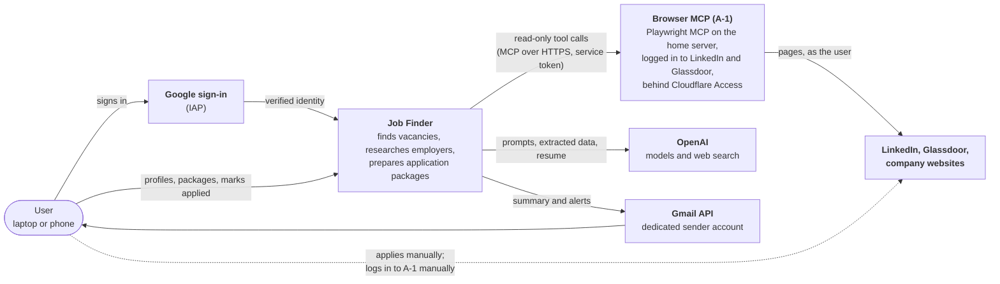
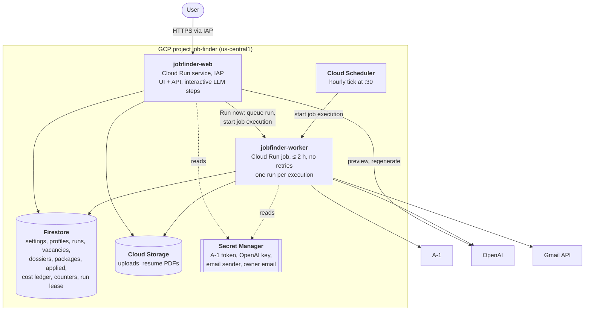
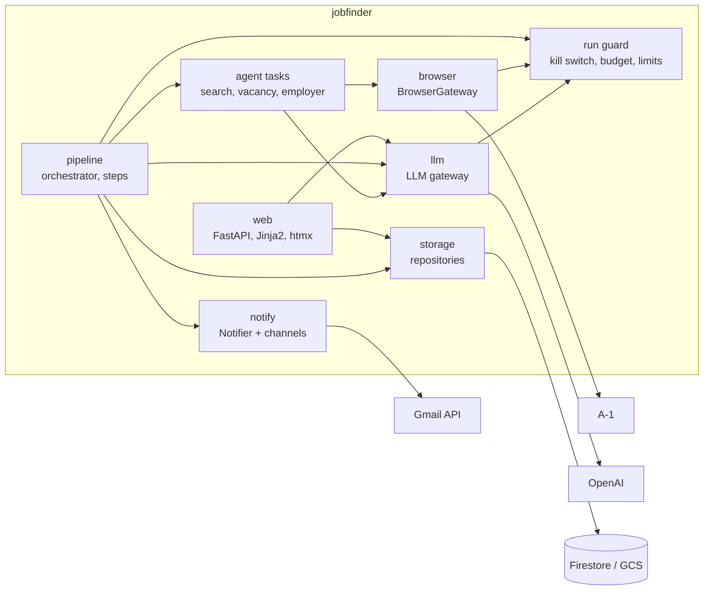
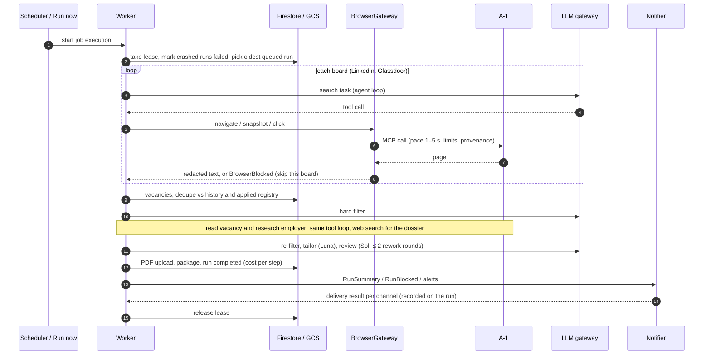
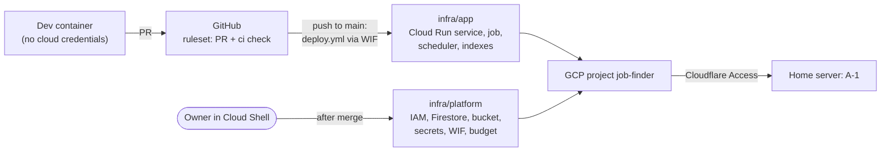

# Architecture

| | |
|---|---|
| **Status** | v1: consolidates ADR-0004 to ADR-0011. Learnings from the walking skeleton (#22) are added when it is done (#23) |
| **Date** | 2026-11-25 |
| **Issues** | #14 (draft), #23 (v1) |
| **Inputs** | [Vision](vision.md), [use cases](requirements/use-cases.md), [NFR](requirements/nfr.md), [ADRs](adr/README.md); spikes: [browser flows](spikes/browser-flows.md), [LLM cost](spikes/llm-cost.md), [application channels](spikes/application-channels.md) |

This page shows how the pieces fit. The decisions and their reasons are in the ADRs it links to. If this page and an ADR disagree, the ADR wins, and this page is fixed.

## 1. Context (C4 level 1)

| External system | Job Finder uses it for | Trust | ADR |
|---|---|---|---|
| Google sign-in via Identity-Aware Proxy | Owner-only access to the web app | Identity verified twice: by IAP, and by the app checking IAP's signed JWT | [0008](adr/0008-user-authentication.md) |
| A-1 Browser MCP | Reading job boards and company sites with the owner's sessions | Its output is **untrusted** (prompt injection). The token allows code execution in A-1's browser, so only `worker` holds it | [0011](adr/0011-browser-automation-policy.md) |
| LinkedIn, Glassdoor, company sites | Vacancies and employer signals, read only, only through A-1 | Never contacted directly | [0011](adr/0011-browser-automation-policy.md) |
| OpenAI | Models for browsing tasks and text steps; web search for the dossier | Receives the resume only in steps that need it; `store=false` | [0004](adr/0004-agent-runtime.md) |
| Gmail API (dedicated sender account) | Summary and alert emails | A token that can only send; no resume content in messages | [0010](adr/0010-email-delivery.md) |

Out of scope:
- operating A-1 and logging in to job boards (the owner does both on A-1);
- submitting applications (#32).

## 2. Containers (C4 level 2)

All of this runs in the GCP project `job-finder`, `us-central1`. Web app and worker share **one container image** with two entry points ([ADR-0005](adr/0005-application-stack.md), [ADR-0006](adr/0006-hosting.md)).

| Container | Responsibility | Key rules |
|---|---|---|
| **jobfinder-web** (Cloud Run service) | All pages and API (UC-01–05, 10–15); resume a blocked run, re-enable a board (UC-08). Interactive LLM steps outside the run queue: extraction preview (UC-03), regenerate answers (UC-11 A1), regenerate and re-review a resume (UC-12) | IAP in front; the app verifies the IAP JWT and the owner email on every route except `/healthz` (ADR-0008). CSRF by `Origin` check. Scales to zero; cold start ≤ 10 s (NFR-A1) |
| **jobfinder-worker** (Cloud Run job) | Executes one queued run end to end (UC-07), then notifies | Takes the run lease, renews it, stops if it is lost; one run per execution, so every run fits the 2 h timeout (ADR-0007). The only workload with the A-1 token |
| **Cloud Scheduler** | Starts the worker every hour at :30 | The worker decides which profiles are due (NFR-R1). A blocked run waits for its next slot, so there is no retry loop (NFR-A2) |
| **Run queue** | No separate service: `runs` documents with status `queued` plus the lease document `locks/worker` | Oldest queued run first; no duplicate queueing per profile; the kill switch drops queued runs (UC-14) |
| **Firestore** | All structured data | TTL on `expire_at`; planned indexes; daily backups kept 7 days; deny-all client rules (ADR-0007) |
| **Cloud Storage** | Uploads and generated PDFs | Private; `packages/pending/` deleted after 90 days, `packages/applied/` kept; soft delete 7 days |
| **Secret Manager** | A-1 id and secret, OpenAI key, `email-sender`, owner email | Values added by the owner, never in the repo, CI or Terraform state (ADR-0009); `worker` reads A-1, OpenAI and email sender; `web` reads OpenAI and the owner email (ADR-0006, ADR-0008, ADR-0010) |

## 3. Application components

One Python package, `jobfinder` ([ADR-0005](adr/0005-application-stack.md)). The diagram shows logical components: most map to a folder (`web`, `pipeline`, `browser`, `llm`, `storage`, and `notify` from ADR-0010); agent tasks live in `pipeline`, the run guard in `pipeline` and `browser`; `domain` holds the shared models and `worker` the entry point.

| Component | Responsibility | ADR |
|---|---|---|
| **pipeline** | UC-07 steps in order; statuses per vacancy; continues past single failures; scopes a block to the board or source where it happened | [0004](adr/0004-agent-runtime.md), [0011](adr/0011-browser-automation-policy.md) |
| **agent tasks** | Short Pydantic AI agents with fresh context, typed output and `UsageLimits` (search 40 tool calls; vacancy or employer 20) | [0004](adr/0004-agent-runtime.md) |
| **browser / BrowserGateway** | The only path to A-1, over one MCP session. Allowed tools: navigate, snapshot, find, click, back, tabs, wait, plus web search for the dossier; no typing, forms, uploads or JavaScript. Enforces URL provenance, the click allowlist, limits and pace, and stop triggers after every result. Redacts owner identifiers | [0011](adr/0011-browser-automation-policy.md) |
| **llm / LLM gateway** | Model registry per step (Luna for most steps, Sol for review); cost per step from usage × price table; budget guard against the monthly cap using each task's worst case; `store=false` | [0004](adr/0004-agent-runtime.md) |
| **notify** | Typed events (RunSummary, RunBlocked, RunFailed, BudgetAlert, RestrictionNotice) → `Notifier` → enabled `NotificationChannel`s. MVP: `EmailChannel` (Gmail API, `gmail.send`); later e.g. Telegram | [0010](adr/0010-email-delivery.md) |
| **storage** | Repository interfaces; Firestore and GCS implementations; in-memory fakes for tests. Nothing else imports a Google client | [0007](adr/0007-data-storage.md) |
| **run guard** | Checked before each step and browser call: kill switch, LLM budget, daily page loads per board, paused boards | NFR-O3, NFR-B5 |
| **web** | Pages, htmx fragments, IAP JWT dependency, Origin check | [0005](adr/0005-application-stack.md), [0008](adr/0008-user-authentication.md) |

## 4. A run, step by step

- A login prompt, challenge or restriction skips **that board** for the rest of the run. The run is *blocked* only if every board is blocked or A-1 is unreachable (ADR-0011 §6, UC-07 A3/A4).
- The run guard is checked before each step: the kill switch stops a run within 1 minute (NFR-O3); the budget guard stops it with *stopped: budget* (NFR-C4).

## 5. Data

The collections, indexes and retention rules are in [ADR-0007](adr/0007-data-storage.md). In short:

| Data | Personal | Retention |
|---|---|---|
| Settings (notification email, re-apply period, kill switch, paused boards) | email | until deleted |
| Profiles with the two uploaded files and extracted fields | **resume** | until the profile is deleted (immediate) |
| Runs, vacancies, cost ledger, counters | — | 12 months |
| Dossiers (employer facts) | — | 90 days unless applied |
| Packages and resume PDFs not applied to | **resume content** | 90 days |
| Applied registry and its packages | links | until the owner deletes them |
| Logs and agent step traces | no resume text | 30 days (NFR-P3, NFR-P6) |

## 6. Trust boundaries and cross-cutting concerns

| Concern | Approach | ADR / NFR |
|---|---|---|
| Access | IAP plus the app's own JWT and owner-email check; fail closed; dev-mode identity refused on Cloud Run | 0008, NFR-S1 |
| Prompt injection | Readers (browsing agents) have only read tools and no personal data; writers (tailor, review) have no browser; typed outputs; URL provenance | 0011 §7, NFR-S6 |
| Secrets | Secret Manager only; values added by the owner; each workload reads only its own | 0006, 0009, NFR-S2 |
| Deployment boundary | Whoever deploys code acts as the app; only reviewed code on `main` deploys; CI has no project-level IAM rights (only invoker bindings on the service and the job) | 0003, 0009 |
| Personal data | Minimal storage; TTL and explicit deletion; no resume in logs, traces or notifications | 0007, 0010, NFR-P1–P6 |
| Cost | Hosting ≈ $0–0.20/month; LLM cap $10 with a budget guard; the LLM budget, not hosting, limits run frequency | 0004, 0006, NFR-C1–C5 |
| Being a polite guest | Limits, pace, stop triggers and exit criteria in `BrowserGateway` | 0011, NFR-B1–B7 |
| Testability | Fakes for LLM (Pydantic AI test models), MCP (#24), storage and notification channels; no test reaches OpenAI, A-1, GCP or Gmail | 0004, 0005, NFR-M5 |

## 7. Deployment

- **Two Terraform layers** ([ADR-0009](adr/0009-infrastructure-as-code.md)):
  - `infra/platform`: IAM, data, secrets, WIF, budget. Applied by the owner from Cloud Shell; its state is owner-only.
  - `infra/app`: Cloud Run service and job, scheduler, indexes. Applied by CI on `main` through WIF.
- **CI identities:**
  - `app-plan`: read-only, for PR plans.
  - `deployer`: only `deploy.yml` on a push to `main`. No project-level IAM, data or secret rights; resource IAM on the service and the job only.
- **Outside Terraform** (manual steps, recorded in the runbook):
  - creating the project, linking billing and adding Firebase (ADR-0009);
  - the email sender's Personal-mode project (ADR-0010);
  - the IAP OAuth client (ADR-0008);
  - secret values.

The steps, in order, are in [docs/runbooks/bootstrap.md](runbooks/bootstrap.md). The repository variables that `app-plan.yml`, `drift.yml` and `deploy.yml` read are listed there; until they are set, the workflows end green with "bootstrap not done".

## 8. Decision log

| Question | Decision | ADR |
|---|---|---|
| Records of decisions; dev environment; branching | ADRs in the repo; dev container with firewall and Claude Code sandbox; trunk-based with squash-merged PRs | [0001](adr/0001-record-architecture-decisions.md), [0002](adr/0002-dev-environment.md), [0003](adr/0003-branching-strategy.md) |
| Agent runtime, provider, models | Pydantic AI, OpenAI, loop in the worker; Luna for most steps, Sol for review | [0004](adr/0004-agent-runtime.md) |
| Stack | Python 3.14, uv, FastAPI + Jinja2 + htmx 2 + Pico, WeasyPrint, one image | [0005](adr/0005-application-stack.md) |
| Hosting | Cloud Run service + job, hourly Scheduler tick, own project, `us-central1` | [0006](adr/0006-hosting.md) |
| Data | Firestore + private bucket, TTL, backups, lease | [0007](adr/0007-data-storage.md) |
| Sign-in | IAP on Cloud Run + app-side JWT check | [0008](adr/0008-user-authentication.md) |
| Infrastructure | Terraform platform/app layers, WIF, one environment | [0009](adr/0009-infrastructure-as-code.md) |
| Notifications | `Notifier` with channels; email via a dedicated Gmail, Personal mode | [0010](adr/0010-email-delivery.md) |
| Browser policy | Allowlists, limits, stop triggers per board, exit criteria | [0011](adr/0011-browser-automation-policy.md) |

## 9. Open items

| Item | Where |
|---|---|
| A-1 validation: one long session without blank pages, LinkedIn filters with allowed clicks only, Glassdoor dialog, stop patterns | ADR-0011 §10, before #27 |
| The Personal-mode refresh token still works 8+ days after issue | #22 |
| Cold start and image size of the web service; worker CPU and memory sizing | #22 (ADR-0006) |
| Recorded pages, fake MCP server, evals including injected vacancy text | #24, #25 |
| Review of the browsing approach against real runs | #38 |
| Skeleton learnings | #23, after #22 |
